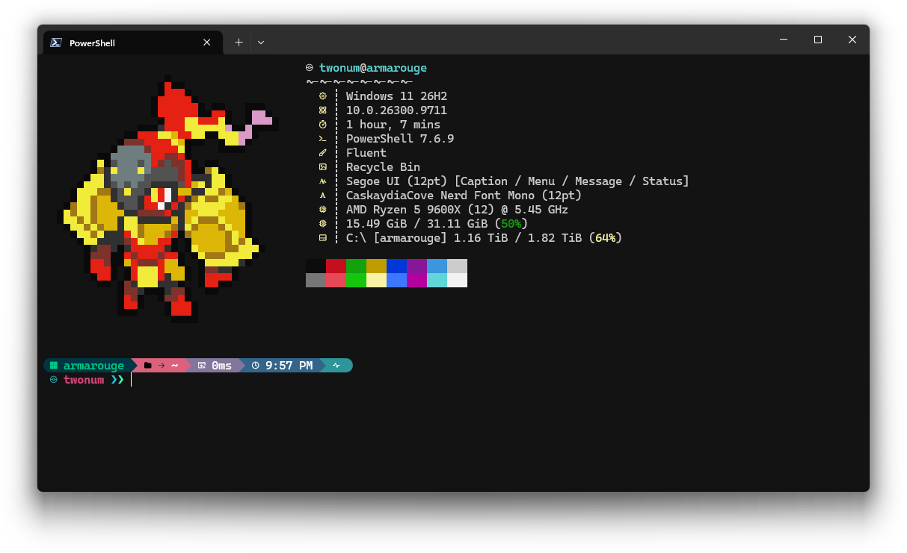

My dotfiles and configuration stuff for Windows (PowerShell) and Debian (Zsh/PowerShell).

The directory structure is mostly flat, symlinked to `$DOTCADENCE/stow` for GNU Stow usage.

You can adapt them; however, don't use them directly as so many things (most notably Pokémon, and the number of files with `pokemon` somewhere) are hardcoded. That said, you can try to fit this to your liking if you want cross-platform Windows and Debian configs.

